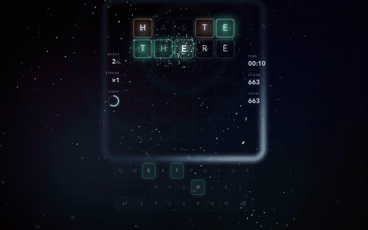
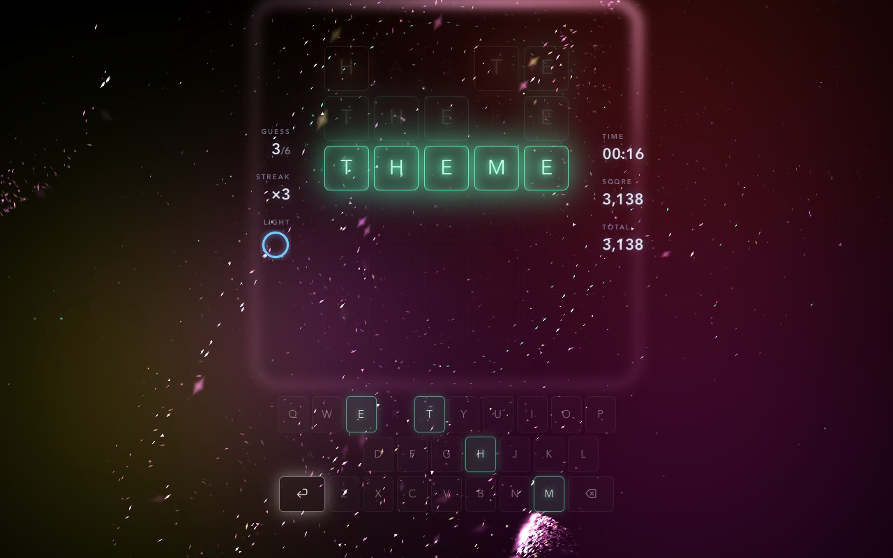

# WordlEffect

A five-letter word game where the world starts as nothing and lights up as you find the answer.

It plays like Wordle: six guesses at a hidden five-letter word. But the screen begins pure black with thirty faint
squares, and every letter you find wakes a little more of it: schools of light, colour clouds, a glowing frame and a
soundtrack that grows from one low drone into piano, bells and a heartbeat. The idea is: what if Wordle were played
the way Tetris Effect plays Tetris? Calm, multi-sensory, and almost wordless.

<p align="center">
  
</p>

**▶ [Watch the full demo with sound (docs/demo.mp4, 25 s)](docs/demo.mp4)** — the sound is half the game.



---

## Contents

- [Playing](#playing)
- [What you see](#what-you-see)
- [What you hear](#what-you-hear)
- [Combos and scoring](#combos-and-scoring)
- [HDR](#hdr)
- [Running it](#running-it)
- [How it works](#how-it-works)
- [Accessibility](#accessibility)
- [Known limits](#known-limits)
- [Credits](#credits)

## Playing

Type a five-letter word and press **Enter**. Each letter is checked in turn, on the beat:

| Tile | Meaning |
| --- | --- |
| Green glass | Right letter, right place |
| Amber glass | The letter is in the word, somewhere else |
| Dim | The letter is not in the word |

Guesses must be real words (about 12,600 are accepted); answers come from 800 common ones. Use your keyboard or the
on-screen keys. When a round ends, the **⏎** key pulses: press Enter to play again. The session total carries over.

There is almost no text on purpose. The only words on screen are the small labels beside the board.

## What you see

- **It starts dark.** Only correct letters bring the light in. Guessing alone doesn't.
- **A school of light.** Thousands of tiny shards drift around the board and glint as they turn.
- **Colour.** Deep blue that slowly warms to teal as you get closer.
- **The frame.** A big glowing square behind the board that reacts to every key you press.
- **Every check flashes.** Each letter lights up white as it's checked, then settles into its colour.
- **Light you keep.** Every green you find adds to a galaxy around the board. Solve it, and it all bursts.

## What you hear

- **Each column has a note.** Green letters play C, E, G, B, C on piano, so solving plays the full chord.
- **Every word has a tune.** Each letter has its own note, so typing a word plays a little melody.
- **Everything lands on the beat.** Letters are revealed in time with the music.
- **The music grows with you.** A quiet drone at first, then pads, bells and a heartbeat as you find letters.
- **It gets tense near the end.** One or two letters left, or few guesses left, and a soft pulse starts ticking.
- **Endings.** Win, and the piano plays your word's tune back to you. Lose, and it plays the answer, softly.

The piano is a real sampled grand. Everything else is made live in the browser, with tiny human imperfections.

## Combos and scoring

- **Chains.** Greens next to each other link up with light and ring out brighter.
- **Streaks.** Find a new green on every guess and rings of light build up around the board.

The side panel shows your guesses, streak and progress on the left, and time and score on the right.

| Event | Points |
| --- | --- |
| New green letter | 100 × (1 + 0.5 per earlier green in its chain) × (1 + 0.25 per streak level) |
| Green you already had | 10 |
| Amber letter | 25 |
| Solving | 500 × (7 − guesses used) |

## HDR

On an HDR display the brightest moments, like the letter flashes, spark cores and glints on the shards, are drawn
brighter than white. This uses a WebGPU canvas in extended tone-mapping mode.

| Browser | What you get |
| --- | --- |
| Chrome / Edge with WebGPU | HDR on HDR displays |
| Safari with WebGPU | Same look; HDR output depends on Safari's support for extended tone mapping |
| No WebGPU (WebGL2) | Same look, clamped to normal brightness |

The demo video was recorded in SDR, so it shows none of this.

## Running it

Requires Node 22.18 or newer (the tests run TypeScript directly).

```bash
npm install
```

```bash
npm run dev
```

Then open http://localhost:5173. Other scripts:

```bash
npm test         # rules: scoring, chains, energy, tension, keyboard states
npm run build    # type-check and build to dist/
npm run lint     # oxlint
```

The piano samples stream from the Tone.js sample host the first time you press a key, so you need to be online for
the piano.

## How it works

| File | What it does |
| --- | --- |
| [`src/App.tsx`](src/App.tsx) | The game: input, reveal timing, the HUD, wiring sound and light together |
| [`src/game.ts`](src/game.ts) | Pure rules: scoring guesses, chains, energy, tension, points ([tests](src/game.test.ts)) |
| [`src/fx.ts`](src/fx.ts) | The light: the school, bursts, galaxy, frame, waves and the letter flashes |
| [`src/gpu.ts`](src/gpu.ts) | A small instanced renderer: WebGPU with HDR, or WebGL2 |
| [`src/audio.ts`](src/audio.ts) | The music: piano sampler, synths, reverb, echo, the beat grid and the drone |
| [`src/words.ts`](src/words.ts) | Answer list and guess validation ([`valid.txt`](src/valid.txt)) |
| [`src/index.css`](src/index.css) | Tiles, keyboard, HUD and their animations |

A few details worth knowing:

- **One draw call.** Every particle, cloud and letter is one GPU quad; the shader decides its shape.
- **Fast.** The simulation takes under a millisecond a frame for about 3,000 particles.
- **No clumping.** The school follows a curl-noise flow, so it streams and swirls but never bunches up.
- **The letters match.** HDR letters use the page's own font metrics, so they line up with the real ones.
- **Sound drives light.** Heartbeats, chord changes and bell notes make the visuals pulse in time.

## Accessibility

- Screen readers hear every result.
- **Reduce motion** cuts particles, the shake and tile animations.
- Fully playable by keyboard.

## Known limits

- No internet, no piano. The rest of the music still plays.
- Random word each round, no daily puzzle or saved stats.
- HDR in Safari isn't confirmed yet (see [HDR](#hdr)).

## Credits

- Piano: [Salamander Grand Piano](https://sfzinstruments.github.io/pianos/salamander) by Alexander Holm, CC-BY 3.0,
  via the [Tone.js](https://tonejs.github.io/) sample host.
- Word list derived from [an-array-of-english-words](https://github.com/words/an-array-of-english-words) (MIT).
- Built with React, TypeScript and Vite.
- Inspired by [Wordle](https://www.nytimes.com/games/wordle/) and [Tetris Effect](https://www.tetriseffect.game/).
  WordlEffect is an independent fan project, not affiliated with or endorsed by The New York Times, Enhance or The Tetris
  Company.
